<p align="center">
  
</p>

<p align="center">
  <a href="https://smart-outcome-predictor-by-master.streamlit.app"><b>🕹️ &nbsp;PRESS START · OPEN LIVE APP</b></a>
  &nbsp;&nbsp;·&nbsp;&nbsp;
  <a href="YOUR_VIDEO_LINK_HERE"><b>🎬 &nbsp;WATCH DEMO</b></a>
  &nbsp;&nbsp;·&nbsp;&nbsp;
  <a href="https://github.com/mayurofficial-tech/Smart-Outcome-Predictor"><b>💻 &nbsp;SOURCE CODE</b></a>
</p>

<p align="center">
  
  
  
  
</p>

---

## 🎮 GAME START SCREEN

```text
╔══════════════════════════════════════════════════════════╗
║   🎓  SMART OUTCOME PREDICTOR                            ║
╠══════════════════════════════════════════════════════════╣
║   PLAYER      :  Student                                 ║
║   QUEST 1     :  Will the student complete the course?   ║
║                  → Output: 0 or 1                        ║
║   QUEST 2     :  What will the final score be?           ║
║                  → Output: 0 – 100                       ║
║   POWER-UPS   :  Bagging · AdaBoost · XGBoost · Stacking ║
║   CONTROLS    :  Streamlit web interface                 ║
╚══════════════════════════════════════════════════════════╝
```

A machine learning project that predicts whether a student will **complete a course** and estimates their **final score**, using supervised learning and ensemble models.

---

## 🕹️ TWO GAME MODES

| | Mode | Question it answers | Output |
|:-:|---|---|---|
| 🎯 | **Classification** | Will the student complete the course? | `0` or `1` |
| 📈 | **Regression** | What will the final score be? | `0 – 100` |

Each mode has its own workflow and its own saved best model.

---

## ⚡ POWER-UPS (Models)

| Power-up | Type |
|---|---|
| 🌲 **Bagging** | Ensemble |
| 🚀 **AdaBoost** | Boosting |
| ⚡ **XGBoost** | Gradient boosting |
| 🗳️ **Voting Classifier** | Ensemble |
| 🧱 **Stacking Classifier / Regressor** | Stacking |
| 🧪 **Baseline models** | For comparison |

---

## 🏆 SCOREBOARD (Evaluation Metrics)

<table>
<tr>
<td width="50%" valign="top">

**🎯 Classification**

- Accuracy
- Precision
- Recall
- F1 Score
- ROC-AUC

</td>
<td width="50%" valign="top">

**📈 Regression**

- MAE
- RMSE
- R² Score

</td>
</tr>
</table>

---

## ✨ FEATURES UNLOCKED

- ✅ Predicts course completion status (0/1)
- ✅ Estimates a student's final score (0–100)
- ✅ Separate classification and regression workflows
- ✅ Compares ensemble learning techniques
- ✅ Interactive Streamlit interface for entering student and course details

---

## 🎛️ HOW TO PLAY

```text
  1️⃣  Open the live app (or run it locally)
        ↓
  2️⃣  Enter the student and course details
        ↓
  3️⃣  Click  [ Predict outcomes ]
        ↓
  4️⃣  Read the predicted completion status + estimated final score
```

---

## 🗺️ LEVEL MAP (Project Structure)

```text
🎓 Smart-Outcome-Predictor/
 ├─ 📄 app.py                              Streamlit app
 ├─ 📁 assets/
 │   └─ 🎞️ game_header.svg                 README header
 ├─ 📁 data/
 │   └─ 📊 Smart_Outcome_Predictor.csv
 ├─ 📁 model/
 │   ├─ 🧠 best_classification_model.pkl
 │   └─ 🧠 best_regression_model.pkl
 ├─ 📁 notebooks/
 │   └─ 📓 models.ipynb
 ├─ 📁 outputs/
 │   └─ 🧾 input_schema.json
 ├─ 📄 requirements.txt
 └─ 📄 README.md
```

---

## ⚙️ START A NEW GAME (Run Locally)

**1️⃣ Clone the repository**

```bash
git clone YOUR_GITHUB_REPOSITORY_LINK_HERE
cd Smart-Outcome-Predictor
```

**2️⃣ Create and activate a virtual environment** *(optional)*

```bash
python -m venv .venv
```

```bash
# Windows
.venv\Scripts\activate

# macOS / Linux
source .venv/bin/activate
```

**3️⃣ Install dependencies**

```bash
pip install -r requirements.txt
```

No `requirements.txt` yet? Install the main packages directly:

```bash
pip install streamlit pandas scikit-learn xgboost joblib
```

**4️⃣ Start the Streamlit app**

```bash
streamlit run app.py
```

---

## 🎒 INVENTORY (Tech Stack)

`Python` · `Pandas` · `NumPy` · `Scikit-learn` · `XGBoost` · `Joblib` · `Streamlit`

---

## 📜 GAME RULES (Notes)

- Keep the saved model files and `outputs/input_schema.json` at the paths expected by `app.py`.
- Model filenames must match the actual files in the `model/` folder.
- Do not commit private data or large files unless you intend to publish them.

---

<p align="center">
  <b>👤 PLAYER PROFILE</b><br>
  <b>Mayur Makwana</b><br>
  <a href="https://github.com/mayurofficial-tech">GitHub</a>
  &nbsp;·&nbsp;
  <a href="YOUR_LINKEDIN_PROFILE_LINK_HERE">LinkedIn</a>
</p>
